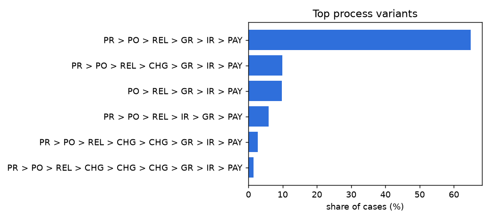
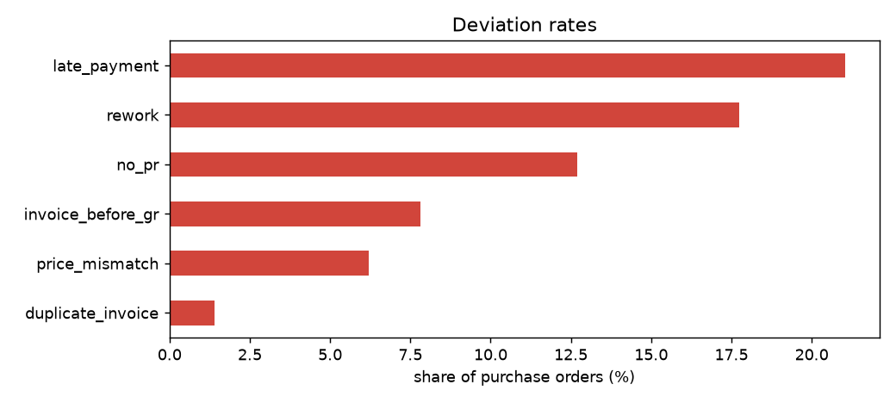

# p2p-lens

[](https://github.com/ChaiebDhia/p2p-lens/actions/workflows/ci.yml)
[](LICENSE)


Procure-to-pay (P2P) process intelligence on SAP-style data. It rebuilds an event log from purchasing
tables, runs process mining and conformance checks, turns the results into citable findings, models
the business value with explicit assumptions, and answers questions about the process with a
**grounded** copilot: every answer must cite a finding and every number must match it, or it is
replaced by a deterministic answer.

Free to run: Python, pandas, no paid API, no cloud account. An LLM is optional (local Ollama or any
OpenAI-compatible endpoint with a free tier).

> **Data note.** The bundled generator produces **synthetic** data. All numbers below come from that
> data and illustrate the method; they say nothing about any real company. See
> [docs/limitations.md](docs/limitations.md).

## Quick start

```bash
git clone https://github.com/ChaiebDhia/p2p-lens.git
cd p2p-lens
python -m venv .venv && source .venv/bin/activate      # Windows: .venv\Scripts\activate
pip install -e ".[plots]"

p2p-lens demo --out out                  # generate data, analyse, write the report
open out/report/report.html              # or report.md (Windows: start out\report\report.html)
p2p-lens ask --data out/data "how many invoices are paid late?"
```

## What it does

| Step | Module | Output |
|---|---|---|
| Model SAP tables | `schema`, `synth` | EKKO, EKPO, EKBE, EBAN plus change and payment tables, with injected ground truth |
| Event log | `eventlog` | One case per purchase order, seven activities |
| Process mining | `mining` | Variants, case durations, directly-follows waiting times |
| Conformance | `conformance` | Precedence rules plus six deviation detectors |
| Findings | `findings` | 11 deterministic, citable statements (F01 to F11) |
| Value model | `value` | Scenario benefits from observed rates times editable assumptions |
| Copilot | `copilot` | TF-IDF retrieval, optional LLM, grounding check, extractive fallback |
| Report | `report` | Executive summary, findings, deviations, value model; Markdown and self-contained HTML, optional charts |
| Export | `export` | `activities.csv` and `cases.csv` in the shape process-mining platforms ingest |

Results on the default synthetic run (`--cases 2000 --seed 42`):




- 25 process variants; the reference path covers 64.9% of cases.
- 21.1% of invoices paid late, 17.8% of orders reworked, 12.7% of orders without a requisition.
- Excluding contractual payment terms, release-to-goods-receipt is the largest source of waiting time,
  and releases of orders above 10,000 EUR take a median of 4.6 days against 1.1 for smaller orders.

## Correctness: detection is checked against injected ground truth

The generator decides each deviation per case from a seeded random draw and records the exact counts.
`tests/test_ground_truth.py` asserts that the analysis, which sees only the tables, recovers those
counts **exactly** for six deviation types across several seeds. If a detector drifts, the test fails.

## The grounding contract

```text
question -> retrieve findings -> (optional) LLM drafts answer -> verify -> answer
                                                                   |
                                    fails? -> deterministic extractive answer
```

An LLM answer is accepted only if it cites at least one retrieved finding id (for example `[F03]`),
cites no id that was not retrieved, and contains no number that is absent from the cited findings.
Otherwise the answer is built directly from the findings and the CLI says it fell back. Tests cover a
hallucinated number, a missing citation, a fake citation and a backend outage.

```bash
p2p-lens ask --data out/data "which vendors are slow?"                       # no LLM
p2p-lens ask --data out/data --backend ollama --model llama3.2 "..."         # local, free
export P2P_LENS_BASE_URL=... P2P_LENS_API_KEY=... P2P_LENS_MODEL=...
p2p-lens ask --data out/data --backend openai "..."                           # any compatible API
```

## Use your own data

- **SAP extracts:** export EKKO, EKPO, EKBE and EBAN (for example from SE16) and supply the two helper
  tables described in [docs/data-model.md](docs/data-model.md), then `p2p-lens analyze --data <dir>`.
- **Hand the data to a process-mining platform:** `p2p-lens export --data <dir> --out export` writes an activity
  table and a case table (with 0/1 deviation flags) ready to load elsewhere.
- **Any event log (XES, XES.gz or CSV):** `p2p-lens analyze-log --log file.xes --out report` gives variants,
  durations and waiting times without SAP tables. Run on a real public log (1,434 cases, 8,577 events)
  in 0.3 s; see [docs/real-data.md](docs/real-data.md). Add `--p2p-map map.yaml` (template in
  `examples/`) to run the precedence and three-way-match checks on a real log by mapping its activity names.

## Value model

`default_assumptions.yaml` holds every euro figure the model uses. Change them before drawing any
conclusion: the output is "observed rate x your assumption", never a forecast. See
[docs/value-model.md](docs/value-model.md).

## Results are reproducible

Every number in this README comes from `p2p-lens demo --cases 2000 --seed 42`, and
`tests/test_readme_numbers.py` fails if the README drifts from a fresh run.

## Development

```bash
pip install -e ".[dev,plots]"
make check        # ruff, mypy --strict, pytest with 90% coverage gate
```

78 tests including property-based tests (Hypothesis), about 98% line coverage, mypy strict, tested locally on
Python 3.12 with pandas 3.1 and 2.2.
CI runs Python 3.11 to 3.13. See [CONTRIBUTING.md](CONTRIBUTING.md) and [docs/architecture.md](docs/architecture.md).

## Scale

100,000 purchase orders (614,690 events) analyse in about 4 seconds and 580 MB peak memory, with detection
still matching ground truth exactly. See [docs/performance.md](docs/performance.md).

## Limitations and roadmap

Synthetic data only out of the box; one case per purchase order; day-level business rules; no Celonis
or PM4Py dependency by design. Roadmap: conformance against a discovered model, a BPI 2019 benchmark run, partial
deliveries and item-level cases. Details in [docs/limitations.md](docs/limitations.md).

## License

MIT, see [LICENSE](LICENSE). Author: Dhia Chaieb.
